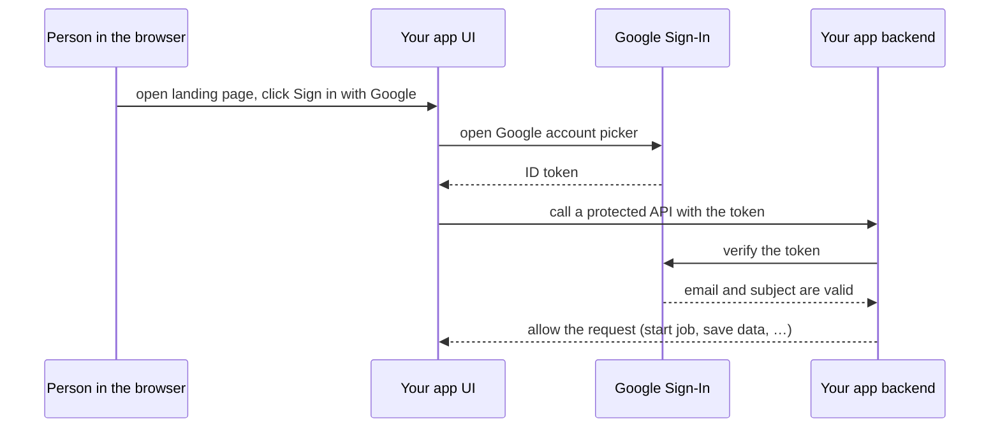

# Cluster Docker Services

Short **how-to** for putting **your** app on the Tower Services cluster. Anyone who wants to share a service can follow this — the live Drone / CEM / DIY LULC apps are examples, not the whole cluster. Start with [Tower Services](../infra/tower-services/index.md) if you do not know the setup or [why Airflow is here](../infra/tower-services/index.md#why-airflow). Tick boxes on the [Cluster Service Checklist](cluster-service-checklist.md) — this page does not repeat that list.

**In one pass:** env in `.env` (never in the image) → three host mounts → deps-only image on GHCR or Docker Hub → Airflow if `AIRFLOW_API_BASE` is set → return a STAC Item → front page + one demo video → [Google Sign-In](#12-google-sign-in-setup).

## 1. Config from env { #1-no-hardcoded-configuration }

Hostnames, passwords, Airflow URLs, and paths come from the environment. Ship `.env.example` with a comment on every variable. Do not commit a real `.env` or put secrets in the `Dockerfile`.

Empty **`AIRFLOW_API_BASE`** turns Airflow **off** (job runs in this container). Do not add `COMPUTE_MODE` or `AIRFLOW_BASE_API_URL`.

Credential **files** (GEE JSON) need both an env var **and** a path that exists in the container (usually because `code/` is mounted). Add a one-command auth check in the repo.

## 2. Mount code, models, and data { #2-code-models-and-data-live-on-the-host-mount-do-not-copy }

The image is **deps-only** (OS/Python packages + start command). The host keeps three folders:

| Host | In the container | What |
| --- | --- | --- |
| **`code/`** | `/app` | Git checkout. Update with `git pull` + restart. |
| **`models/`** | `/app/models` | Weights. |
| **`data/`** | `/app/data` | Inputs, caches, **all output**, logs at `data/logs/<app-name>/`. |

Rebuild the image only when requirements change. A laptop can mount `.` at `/app`; **cluster deploy** uses the three mounts.

## 3. README and VERSION

The repo README must be enough to install: purpose, Docker, clone layout, `.env`, `docker pull` with a **pinned tag**, run command, health check, upgrade, proxy notes.

Keep a root **`VERSION`** (or changelog). Tag images with the same number (`:1.2.0`), not only `:latest`.

## 5. Push a deps-only image { #5-ghcr-or-docker-hub--build-push-and-keep-updated }

Push to **GHCR** or **Docker Hub**. The Dockerfile copies **requirements only**, not application source:

```dockerfile
FROM python:3.11-slim
WORKDIR /app
COPY deploy/requirements-docker.txt /tmp/requirements.txt
RUN pip install --no-cache-dir -r /tmp/requirements.txt
EXPOSE 8000
CMD ["uvicorn", "backend:app", "--app-dir", "src", "--host", "0.0.0.0", "--port", "8000"]
```

```bash
docker build -t <registry>/<name>:1.0.0 .
docker push <registry>/<name>:1.0.0
```

Also: `/health`, `LOG_LEVEL` (`debug` \| `info` \| `error`), `--restart unless-stopped`, listen on `0.0.0.0`, document CPU/RAM/GPU. Avoid host ports that clash with GeoServer (8080) and the backend (8000).

## 7. Describe the job in STACD YAML { #7-writing-dags--stacd-yaml-workflow }

Do not hand-write Airflow Python. Upload **three** YAMLs in Airflow: **STACD → Initialize Workflow**. Full YAML guide: [STACD §11](https://github.com/SaharshLaud/STACD_framework/blob/dev/README.md#11-writing-your-own-yaml-workflow).

| File | What it is |
| --- | --- |
| DAG YAML | Steps, dependencies, trigger params |
| Algorithm Repo YAML | How each step runs — **API** (`url:`) or **Docker** (`image` + `module.function`) |
| Dataset Repo YAML | Inputs that no algorithm produces |

`url:` / the worker must reach **this** app from Airflow (`CORESTACK_API_BASE` — not `localhost` unless they share a network). Pin the Docker `image` tag. Docker-mode tasks print a STAC Item between `===RESULT_JSON_START===` / `===RESULT_JSON_END===`. Record the new **`dag_id`** as `AIRFLOW_DAG_ID`. Update later with STACD plugin pages, not by editing generated `.py`.

## 8. Start the job from your app { #8-compute-and-processing--always-via-airflow }

| `AIRFLOW_API_BASE` | What happens |
| --- | --- |
| **Set** | Your **backend** (not the browser) triggers Airflow and polls until `success` or `failed`. |
| **Empty** | Work runs in this container. Still write `data/` and return a STAC Item. |

Why the cluster prefers “set”: [Tower Services — Why we use Airflow](../infra/tower-services/index.md#why-airflow).

```bash
# start
curl -u "$AIRFLOW_USERNAME:$AIRFLOW_PASSWORD" -H "Content-Type: application/json" \
  -X POST "$AIRFLOW_API_BASE/dags/$AIRFLOW_DAG_ID/dagRuns" \
  -d '{"conf": {"param1": "value1"}}'
# poll until success or failed
curl -u "$AIRFLOW_USERNAME:$AIRFLOW_PASSWORD" \
  "$AIRFLOW_API_BASE/dags/$AIRFLOW_DAG_ID/dagRuns/$DAG_RUN_ID"
```

Env to document: `AIRFLOW_API_BASE`, `AIRFLOW_DAG_ID`, `AIRFLOW_USERNAME` / `AIRFLOW_PASSWORD` (or `AIRFLOW_TOKEN`), `CORESTACK_API_BASE`.

UI → **your** `/api/dag/run` and `/api/dag/status`. Never call Airflow from JavaScript (no CORS; credentials stay off the page). Enable Airflow Basic Auth if REST returns 401. Unpause the DAG before the first trigger.

Details: [STACD §9](https://github.com/SaharshLaud/STACD_framework/blob/dev/README.md#9-triggering-and-monitoring-airflow-dags-via-the-rest-api).

## 9. Return a STAC Item { #9-always-return-output-in-stac-format }

The deliverable is a **STAC 1.x Feature**, not a bare file path or GeoServer layer name. Shape and field names: [STAC Specs](../use-precomputed-data/stac-specs.md) and [stac.core-stack.org](https://stac.core-stack.org/).

Must have: `type` (`Feature`), `stac_version`, `id`, `geometry`, `bbox`, `collection`, `properties` (`title`, `description`, `datetime`, `start_datetime`, `end_datetime`, `keywords`), `links` (`root`, `collection`, `parent`), `assets.data` with a fetchable `href`. Vectors also need the [table extension](https://stac-extensions.github.io/table/v1.2.0/schema.json) and `table:columns` for **every** attribute. Add `style` and `thumbnail` assets when you can.

API-mode services may wrap the Item as `{ "status", "asset_id", "stac_items": [ … ] }` if STACD expects that envelope.

## 11. Front page and demo video { #11-front-page-and-demo-video }

The service URL (for example `/drone`) opens a **landing page** like [Drone](https://www.cse.iitd.ernet.in/act4dws5/drone/): what the project is, then login, then the working UI. On that same page: **one** short video that is both a project intro and a create → run → FileBrowser tutorial. The video is **reviewed and approved**. Same acceptance as [checklist §11](cluster-service-checklist.md#11-front-page-and-demo-video).

## 12. Google Sign-In setup { #12-google-sign-in-setup }

Tower Services apps use **Google Sign-In** so people open your page, click **Sign in with Google**, and only then can start a job or change data. This is the same rule as [checklist §4](cluster-service-checklist.md#4-google-sso-is-implemented).

You do **not** need a paid Google Cloud account. A normal Gmail (or Google Workspace) account is enough. You do **not** need billing for Sign-In alone — do not start a free trial unless you also need other Cloud products.

This section is for a student, researcher, or individual putting a **new** service on the cluster. Work through it once on your laptop, then add the cluster URL before you ask for a deploy.

### What you are building

| Piece | Who does it | Plain meaning |
| --- | --- | --- |
| **Google Cloud project** | You, in a browser | A folder in Google that owns your Sign-In credentials |
| **OAuth consent screen** | You | The page Google shows: “App X wants your email” |
| **Web client ID** | You | A public string your frontend uses to open the Google button |
| **Client secret** | You (server only) | A private string. Put it in `.env`, never in git or browser JavaScript |
| **Sign-In button** | Your frontend | Calls Google, gets an **ID token** (a short-lived signed string) |
| **Token check** | Your backend | Verifies the token with Google before run / upload / delete APIs |

Google Earth Engine service-account JSON is a **different** credential. Do not mix it with Sign-In. GEE keys stay under mounts / env as in [§1](#1-no-hardcoded-configuration).



### Words used below

| Word | Meaning |
| --- | --- |
| **Client ID** | Looks like `1234567890-abc….apps.googleusercontent.com`. Safe to put in the frontend env. |
| **Client secret** | Only for server-side token exchange. Many Sign in with Google button flows need the **Client ID** on the server to verify tokens, and keep the secret out of the browser either way. |
| **Authorized JavaScript origins** | The website origins allowed to start Sign-In. Scheme + host (+ port). No path. Example: `http://localhost:8000`. |
| **Authorized redirect URIs** | Full callback URLs if your app uses a redirect after login. Scheme + host + path. Must match exactly. |
| **ID token** | JWT Google returns after a successful sign-in. Your backend verifies it; do not treat “I saw a token in the browser” as enough. |
| **External** user type | Anyone with a Google account can try to sign in. Fine for campus demos and open research tools while you are testing. |

### Step 1 — Create a Google Cloud project

1. Open [Google Cloud Console](https://console.cloud.google.com/) and sign in with the Google account that will **own** the app credentials (your personal Gmail is fine for a student project).
2. Open the project picker (top bar) → **New project**.
3. Name it after your service, for example `tower-drone-trees` or `diy-lulc-signin`. Create it and select it.

You do not need to link a billing account for Sign-In.

### Step 2 — Configure the OAuth consent screen

1. Go to **APIs & Services** → **OAuth consent screen** (or [Google Auth Platform](https://console.cloud.google.com/auth/overview) if the console has moved the menu).
2. Choose **External** (unless you only serve people inside a Google Workspace you administer).
3. Fill the required fields:

| Field | What to put |
| --- | --- |
| App name | The name people will see, for example `DIY LULC` |
| User support email | Your email |
| Developer contact email | Your email |

4. Scopes: for Tower Services login you usually only need basic profile / email (the defaults for Sign in with Google). Do not request Drive, Gmail, or Cloud scopes unless the app truly needs them.
5. **Test users** (while the app is in **Testing**): add every Google account that must sign in during development — yourself, your advisor, teammates. Until you publish the app, only listed test users can complete Sign-In.
6. Save. You can leave the app in **Testing** for local work and early demos. Publishing for production is a later Google review step; ask a cluster maintainer when your service is accepted.

### Step 3 — Create an OAuth Web client

1. Go to **APIs & Services** → **Credentials** → **Create credentials** → **OAuth client ID**.
2. Application type: **Web application**.
3. Name: for example `tower-service-web`.
4. Under **Authorized JavaScript origins**, add every origin where the UI will run. No path, no trailing slash quirks — match what the browser shows in the address bar.

| Where you run | Example origin |
| --- | --- |
| Laptop | `http://localhost:8000` (use your real port) |
| Also add | `http://localhost` if Google’s form asks for it |
| Cluster (after you know the path) | `https://www.cse.iitd.ernet.in` — host only for origins; the `/act4dws5/your-app` path is **not** part of the origin |

5. Under **Authorized redirect URIs**, add a URI only if your code uses a **redirect** callback (server receives `?code=`). Example shapes:

| Where | Example redirect URI |
| --- | --- |
| Laptop | `http://localhost:8000/auth/google/callback` |
| Cluster | `https://www.cse.iitd.ernet.in/act4dws5/your-app/auth/google/callback` |

If you use the [Sign in with Google button](https://developers.google.com/identity/gsi/web) with a JavaScript callback (no full-page redirect), you still need the **JavaScript origins**; redirect URIs may be optional. Follow whatever your chosen library documents.

6. Click **Create**. Copy:

- **Client ID** → `GOOGLE_CLIENT_ID` (or `VITE_GOOGLE_CLIENT_ID` / `REACT_APP_GOOGLE_CLIENT_ID` if the frontend build inlines it)
- **Client secret** → `GOOGLE_CLIENT_SECRET` in **server** env only

Store both in a password manager or a local `.env` that is gitignored. Put **placeholders** in `.env.example` only.

### Step 4 — Put credentials in env (never in source)

In `.env.example`:

```dotenv
# Google Sign-In (OAuth Web client). Never commit real values.
GOOGLE_CLIENT_ID=your-client-id.apps.googleusercontent.com
GOOGLE_CLIENT_SECRET=your-client-secret
# Frontend frameworks that bake env at build time often need a VITE_ / REACT_APP_ copy of the client ID only:
# VITE_GOOGLE_CLIENT_ID=your-client-id.apps.googleusercontent.com
```

Rules:

- Client ID may appear in the browser. Client secret must **not**.
- Do not hardcode either string in `src/`, Dockerfiles, or GitHub Actions logs.
- On the cluster, the maintainer injects real values into the host env / Compose file. Your image stays deps-only ([§5](#5-ghcr-or-docker-hub--build-push-and-keep-updated)).

### Step 5 — Add Sign-In to the frontend

On the landing page (after the project story, before the working tool — see [§11](#11-front-page-and-demo-video)):

1. Load Google’s script on pages that show the button:

```html
<script src="https://accounts.google.com/gsi/client" async defer></script>
```

2. Render the official **Sign in with Google** button with your `GOOGLE_CLIENT_ID`.
3. When Google succeeds, your callback receives a **credential** (ID token). Send that token to **your** backend on every protected call, for example:

```http
Authorization: Bearer <id-token>
```

or a cookie your backend sets after it has verified the token once. Prefer verifying on the server; do not trust a bare email string the browser sends.

Official overview: [Sign in with Google for Web](https://developers.google.com/identity/gsi/web).

### Step 6 — Validate on the backend

Your backend must:

1. Read the token from the header or session.
2. Verify it with Google (signature, audience = your **Client ID**, expiry). Use a maintained library for your language (for example Google’s token-verify helpers, or `google-auth` in Python).
3. Reject the request with **401** if verification fails or the token is missing.
4. Only then allow: start compute, call Airflow, write under `data/`, delete outputs, change settings.

Public GETs that only show the marketing landing page can stay open. **`POST` that starts a job must not.**

Quick mental test: open the browser private window, skip Sign-In, call your “run” API with `curl` and no token → must fail.

### Step 7 — Protect the right routes

| Allow without Sign-In | Require Sign-In |
| --- | --- |
| Landing HTML, static assets, `/health` | Start job / DAG trigger |
| Public docs links you choose to expose | Upload input, delete run, admin-style settings |

Airflow credentials stay on the **server** ([§8](#8-compute-and-processing--always-via-airflow)). The browser never gets `AIRFLOW_PASSWORD`. Sign-In proves **who** may ask **your** backend to trigger Airflow.

### Step 8 — Local laptop vs cluster URLs

Do this in order:

1. Get Sign-In working on `http://localhost:<port>` with that origin (and redirect, if any) listed in the Google client.
2. When the cluster path is known (for example `/act4dws5/your-app`), **edit the same OAuth client** and add the production JavaScript origin and redirect URI. Do not create a second client unless you intentionally separate “dev” and “prod” projects.
3. Wait a few minutes after saving Google Console changes if the browser still shows `redirect_uri_mismatch` or origin errors.
4. Document both URLs in the service README so the next student on the repo knows what to add in Google Cloud.

Same-origin proxy tip: the browser origin is the **public** host (for example `https://www.cse.iitd.ernet.in`), not the Docker service name. Put that public origin in Google’s form.

### Step 9 — Check that it works

| Check | Pass looks like |
| --- | --- |
| Consent screen | You see your app name and can continue |
| Button | Google account picker opens from the landing page |
| First API after login | Backend accepts the token; job or “whoami” succeeds |
| No token | Compute / write API returns 401 |
| `.env.example` | Lists the variable names; repo has no real secret |
| Logs | Auth success/fail at `info` without printing the token or client secret ([checklist §5](cluster-service-checklist.md#5-logging-enabled-logs-mounted-from-datalogsapplication_name)) |

### If something fails

| What you see | What to try |
| --- | --- |
| `origin_mismatch` / blocked origin | Add exact `http://localhost:<port>` or the cluster origin under **Authorized JavaScript origins**. No path. |
| `redirect_uri_mismatch` | Redirect URI in code and in Google Console must match character-for-character (http vs https, trailing slash, path). |
| “Access blocked: app is in testing” | Add the Google account under **Test users**, or publish the consent screen when you are ready. |
| 401 on every API after a “successful” button click | Backend is not verifying the token, or it is checking the wrong Client ID (frontend and backend must use the same Web client). |
| Works on laptop, fails on cluster | Production origin / redirect not added yet; or frontend still points at a localhost Client ID from an old build. Rebuild/restart so env is picked up. |
| Campus proxy oddities | Sign-In talks to `accounts.google.com` from the **browser**. Proxy issues usually affect `docker pull`, not the Google button. See [IIT Delhi proxy](#cluster-notes-iit-delhi-proxy) only if image pulls fail. |

### Done when

- Landing page shows Sign in with Google.
- Protected APIs reject unauthenticated calls.
- Secrets live only in env; `.env.example` documents the names.
- Local origins work; cluster origins are listed before go-live.

Then tick [checklist §4](cluster-service-checklist.md#4-google-sso-is-implemented).

## Copy-this: Custom LULC { #worked-example-custom-lulc }

Working pattern: [salil-123/Project](https://github.com/salil-123/Project) and the [STACD LULC report](https://github.com/SaharshLaud/STACD_framework/blob/dev/report/custom_lulc_deployment_and_airflow_pipeline.md).

| Piece | Value |
| --- | --- |
| Image | `salil2003/corestack-lulc` (deps only) |
| DAG | `corestack_lulc` |
| Glue | `src/airflow_client.py` — trigger + poll |
| Work endpoint | `POST /api/export-asset` (what the DAG calls back) |
| YAMLs | `deploy/stacd/*.yaml` |

On a laptop you can mount `.` at `/app`. On the cluster use the three mounts in §2. Empty `AIRFLOW_API_BASE` turns the DAG path off. To add the same glue to another HTTP app: those six files + env, then `curl /api/health` → work endpoint → Airflow trigger.

## IIT Delhi proxy { #cluster-notes-iit-delhi-proxy }

If `docker pull` times out on campus, set the **Docker daemon** proxy. Do not put `registry-1.docker.io` or `auth.docker.io` in `NO_PROXY`. Same snippet: [Tower Services](../infra/tower-services/index.md#docker-pull-behind-the-iit-delhi-proxy).

**Inside containers**, set `HTTP_PROXY` / `HTTPS_PROXY` **and** list every Docker hostname you call in **both** `NO_PROXY` and `no_proxy`. Otherwise Squid returns `503` / `ERR_DNS_FAIL` for names like `corestac-stacd-airflow`. Full table, Compose template, Nginx path stripping, deploy and update steps: [Deploy, update, and troubleshoot](../infra/tower-services/deploy-and-troubleshoot.md).
