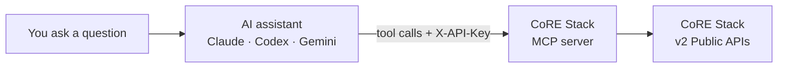

# MCP (Model Context Protocol)

<div class="mcp-hero" markdown>

<span class="mcp-eyebrow">:material-robot-happy-outline: For AI assistants &amp; agents</span>

<p class="mcp-hero__title">Ask questions about rural landscapes in plain language</p>

Connect your AI assistant to **CoRE Stack** (*Commoning for Resilience and Equity*) through the Model Context Protocol. The CoRE Stack MCP server exposes public geospatial and socio-ecological data for rural India, organised by **micro-watershed (MWS)**. You can explore datasets, compare places, chart trends and build lightweight dashboards without writing API calls yourself.

<div class="mcp-url" markdown>
<span class="mcp-url__label">MCP server URL</span>
`https://mcp.core-stack.org/mcp`
</div>

[:material-key-variant: Get an API key](https://dashboard.core-stack.org/){ .md-button .md-button--primary }
[:material-connection: Connect your client](#connect-your-ai-client){ .md-button }

</div>

---

## How it works



The server returns watershed rows, time series and GeoJSON, and the assistant turns them into an answer, a chart, a map or a small dashboard.

<div class="grid cards mcp-steps" markdown>

-   :material-numeric-1-circle:{ .lg .mcp-accent } **Get a key**

    ---

    Generate an `X-API-Key` from the [dashboard](https://dashboard.core-stack.org/) or the Auth APIs.

    [:octicons-arrow-right-24: Authentication](#authentication)

-   :material-numeric-2-circle:{ .lg .mcp-accent } **Connect your client**

    ---

    Add the server URL and key to Claude Code, Claude Desktop, Codex or Gemini CLI.

    [:octicons-arrow-right-24: Setup guides](#connect-your-ai-client)

-   :material-numeric-3-circle:{ .lg .mcp-accent } **Ask a question**

    ---

    Name a place or drop a coordinate, then ask. The assistant picks the right tools.

    [:octicons-arrow-right-24: Example prompts](#use-cases-example-prompts)

</div>

---

## Coverage

:material-map-marker-radius:{ .mcp-accent } Precomputed datasets are available for **~500 tehsils (blocks) across 28 states and union territories**. Coverage is densest in Jharkhand, Maharashtra, Odisha, Rajasthan, Gujarat, Andhra Pradesh and Madhya Pradesh.

!!! tip "Check live coverage"
    New tehsils are added continuously on partner request, so ask your AI client to call `get_active_locations` to see what is available today. If your location is not covered yet, submit a request through the [Geospatial Data Request Form](https://dashboard.core-stack.org/locationForm/).

---

## Authentication

The CoRE Stack MCP server uses the same `X-API-Key` authentication as the [Public APIs](public-apis.md#1-authentication). Get a key in either of these ways:

<div class="grid cards" markdown>

-   :material-view-dashboard-outline:{ .lg .mcp-accent } **Dashboard**

    ---

    [Register or sign in at dashboard.core-stack.org](https://dashboard.core-stack.org/) and generate an API key from your account.

-   :material-api:{ .lg .mcp-accent } **Auth APIs**

    ---

    Call `POST /api/v1/auth/login/` to get a JWT `access` token, then call `POST /api/v1/generate_api_key/` with `Authorization: Bearer <access>`.

</div>

See [Public APIs: Authentication](public-apis.md#1-authentication) for full `curl` examples.

---

## Connect Your AI Client

Replace `<your-api-key>` with your `X-API-Key` in any of the clients below.

=== ":material-console: Claude Code"

    Add the CoRE Stack MCP server from your terminal:

    ```bash
    claude mcp add --transport http core-stack https://mcp.core-stack.org/mcp \
      --header "X-API-Key: <your-api-key>"
    ```

    - Add `--scope user` to make it available across all projects, or `--scope project` to write it to a shared `.mcp.json` file.
    - Verify the connection with `claude mcp list`, or run `/mcp` inside a Claude Code session.

=== ":material-monitor: Claude (Desktop & Web)"

    **Option A: Remote connector (Claude Web / Desktop)**

    1. Open **Settings → Connectors** (or **Integrations**).
    2. Click **Add custom connector**, name it `core-stack`, and enter `https://mcp.core-stack.org/mcp`.
    3. Provide your `X-API-Key` header when prompted.

    **Option B: Claude Desktop config file**

    Edit `claude_desktop_config.json`:

    | OS | Path |
    | --- | --- |
    | :material-apple: macOS | `~/Library/Application Support/Claude/claude_desktop_config.json` |
    | :material-microsoft-windows: Windows | `%APPDATA%\Claude\claude_desktop_config.json` |
    | :material-linux: Linux | `~/.config/Claude/claude_desktop_config.json` |

    ```json
    {
      "mcpServers": {
        "core-stack": {
          "command": "npx",
          "args": [
            "-y",
            "mcp-remote",
            "https://mcp.core-stack.org/mcp",
            "--header",
            "X-API-Key:${CORE_STACK_API_KEY}"
          ],
          "env": {
            "CORE_STACK_API_KEY": "<your-api-key>"
          }
        }
      }
    }
    ```

    Restart Claude Desktop after saving.

=== ":material-code-braces: Codex CLI"

    Add the server in `~/.codex/config.toml` (or your project's `.codex/config.toml`):

    ```toml
    [mcp_servers.core-stack]
    url = "https://mcp.core-stack.org/mcp"
    http_headers = { "X-API-Key" = "<your-api-key>" }
    ```

    Then check connected servers:

    ```bash
    codex mcp list
    ```

=== ":material-star-four-points-outline: Gemini CLI"

    Add the CoRE Stack MCP server with the Gemini CLI:

    ```bash
    gemini mcp add --transport http core-stack https://mcp.core-stack.org/mcp \
      --header "X-API-Key: <your-api-key>"
    ```

    Or add it directly to `~/.gemini/settings.json` (or `.gemini/settings.json` in a workspace):

    ```json
    {
      "mcpServers": {
        "core-stack": {
          "httpUrl": "https://mcp.core-stack.org/mcp",
          "headers": {
            "X-API-Key": "<your-api-key>"
          }
        }
      }
    }
    ```

    Verify with `gemini mcp list`, or run `/mcp` inside a Gemini CLI session.

---

## Capabilities

The MCP server exposes CoRE Stack's **v2** public data APIs (see [Public APIs](public-apis.md#3-public-api-endpoints) and [API Metadata](api-metadata.md)) across five areas.

<div class="grid cards mcp-caps" markdown>

-   :material-map-search-outline:{ .lg .mcp-accent } **1. Place discovery & coordinate lookup**

    ---

    - `get_active_locations`: browse states, districts and tehsils that have precomputed data, with optional `state`, `district` and `tehsil`/`block` filters.
    - `get_admin_details_by_latlon`: turn a WGS84 latitude/longitude into its `State`, `District` and `Tehsil`.
    - `get_mwsid_by_latlon`: turn a latitude/longitude into the ID of the micro-watershed that contains it (`mws_id` / `uid`).

-   :material-table-large:{ .lg .mcp-accent } **2. Tehsil-wide analytical datasets**

    ---

    `get_tehsil_data` returns watershed-level rows across **~40 datasets**, filtered with `data=` in v2. See the dataset families below.

-   :material-water-outline:{ .lg .mcp-accent } **3. Single micro-watershed deep dive**

    ---

    - `get_mws_data`: fortnightly (~15-day) evapotranspiration (ET), runoff and precipitation time series, with units and optional `fields=` filtering.
    - `get_mws_kyl_indicators`: a "Know Your Landscape" (KYL) indicator snapshot with units and code-to-label legends.
    - `get_mws_report`: a link to a ready-made PDF/HTML micro-watershed report.

-   :material-waves:{ .lg .mcp-accent } **4. Waterbodies**

    ---

    - `get_waterbodies_data_by_admin`: every remotely sensed surface waterbody in a tehsil, with seasonal water availability, area, zone of influence (`zoi`) and nearby cropping intensity (`zoi_properties`).
    - `get_waterbody_data`: detailed indicators for a single waterbody by `uid`.

-   :material-layers-outline:{ .lg .mcp-accent } **5. Maps & GIS layers**

    ---

    - `get_mws_geometries` and `get_village_geometries`: micro-watershed and village/panchayat polygons as GeoJSON `FeatureCollection`s, or single features by `mws_id` / `village_id`.
    - `get_generated_layer_urls`: GeoServer WFS (vector) and WCS (raster) layer URLs you can open directly in QGIS. Only GeoServer-synced layers are listed.

</div>

### Dataset families in `get_tehsil_data`

<div class="grid cards mcp-families" markdown>

-   :material-water:{ .mcp-water } **Water**

    Annual and seasonal hydrology (ET, runoff, rainfall, groundwater change), stage of groundwater extraction (SOGE), aquifers, surface waterbodies, drainage, streams, rivers and canals.

-   :material-sprout:{ .mcp-agri } **Agriculture**

    Cropping intensity, kharif cropping vs. drought years, drought frequency and causes, soil health and type, and agro-ecological zones.

-   :material-pine-tree:{ .mcp-forest } **Land & forest**

    Land use / land cover (LULC), tree canopy cover and height, change detection (deforestation, afforestation, degradation, urbanisation), restoration and green-credit opportunities, and terrain.

-   :material-account-group:{ .mcp-socio } **Socio-economic**

    MGNREGA works and assets, Antyodaya/SECC indicators, livestock, distance to facilities, mining, factory/CSR sites and land conflicts.

</div>

!!! warning "Good to know when querying through MCP"
    - **Removing duplicates across tehsils:** a tehsil includes every micro-watershed that overlaps its boundary, so neighbouring tehsils share some. When comparing or summing across tehsils, ask your assistant to de-duplicate on `uid` / `mws_id`.
    - **Pan-India MWS lookup:** `get_mwsid_by_latlon` works for coordinates anywhere in India, even where a tehsil's GeoServer layer is not published yet.
    - **Zero means none:** `forest_fire` (including KYL `fire_count_per_year`) and `mining` return `0` when there are no occurrences. A `0` is not missing data.
    - **Hydrology fallback:** if `get_mws_data` returns `404 LAYER_NOT_PUBLISHED`, use `get_tehsil_data` with `data=hydrological_seasonal` instead.

---

## Use Cases & Example Prompts

Give your AI assistant a place (a state/district/tehsil name or a latitude/longitude) and a question. It fetches the relevant datasets and can compare watersheds, draw charts or build a small interactive dashboard.

<div class="grid cards mcp-usecases" markdown>

-   :material-sprout:{ .lg .mcp-agri } **Agricultural & cropping intensity assessment**

    ---

    Find low-intensity or drought-stressed farmland to prioritise irrigation and watershed work.

    > Which watersheds in Badlapur, Jaunpur have the lowest cropping intensity?
    >
    > Rank micro-watersheds in this tehsil by single-cropped vs. double-cropped area and highlight where cropping intensity declined.

-   :material-water-alert-outline:{ .lg .mcp-water } **Groundwater security & drought history**

    ---

    Combine coordinate lookup, hydrology time series, KYL snapshots and SOGE/drought tables for a quick site assessment.

    > Here's a coordinate: what's the groundwater trend and drought history there?
    >
    > Chart fortnightly rainfall vs. runoff and evapotranspiration for the micro-watershed containing my village.

-   :material-forest:{ .lg .mcp-forest } **Forest cover, restoration & land-use change**

    ---

    Compare tree-cover change, deforestation, afforestation and restoration or green-credit opportunities across blocks or districts.

    > Compare tree-cover loss across the tehsils of Kullu district.
    >
    > Find watersheds with high restoration opportunity and summarise their terrain and LULC mix.

-   :material-waves:{ .lg .mcp-water } **Waterbody & seasonal irrigation planning**

    ---

    Screen surface waterbodies for how long they hold water each season and how much farmland they serve.

    > List the waterbodies in Dumka tehsil that dry up before rabi season.
    >
    > Which waterbodies have the largest zone of influence and highest croppable area nearby?

-   :material-map-outline:{ .lg .mcp-socio } **GIS exports & rapid dashboards**

    ---

    Pull GeoJSON boundaries and join them with analytical tables or GeoServer layers for field teams and reports.

    > Fetch the micro-watershed GeoJSON for this tehsil, join it with KYL drought and groundwater indicators, and build a quick interactive map.
    >
    > Give me the QGIS WFS/WCS layer URLs and the MWS report link for this coordinate.

</div>
